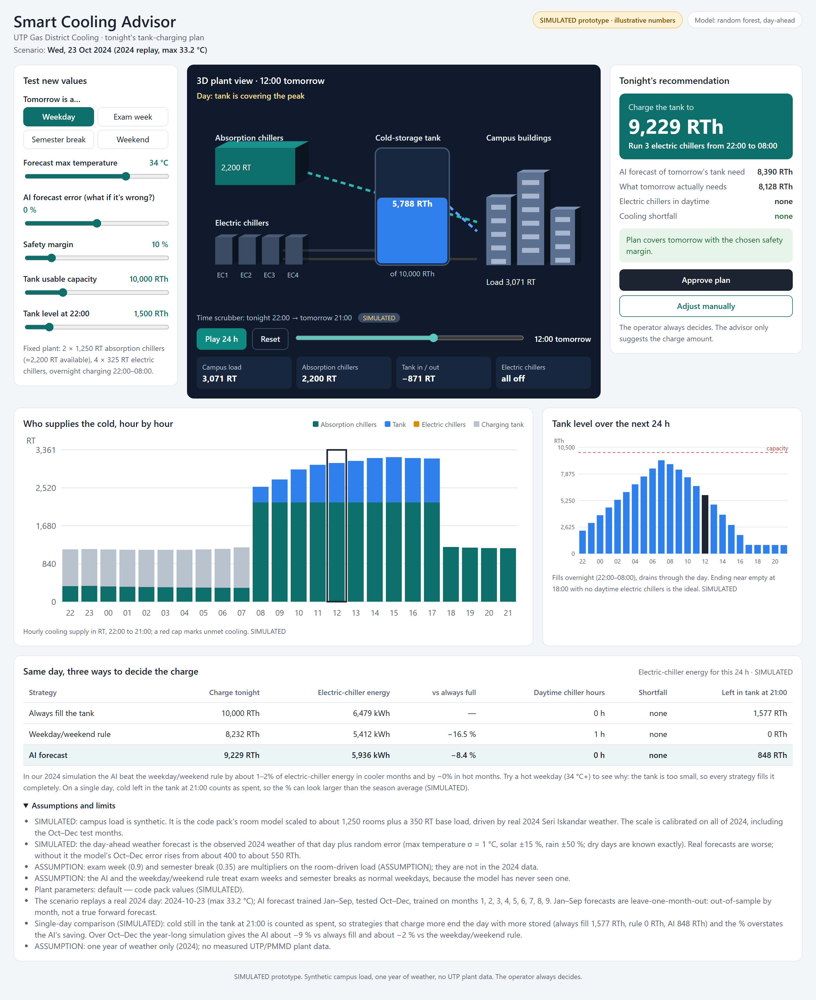
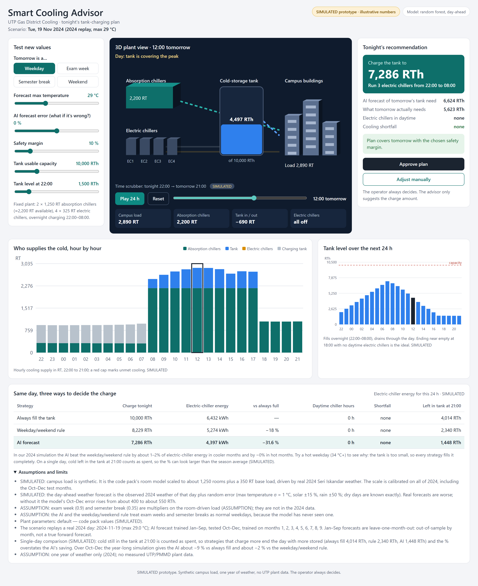
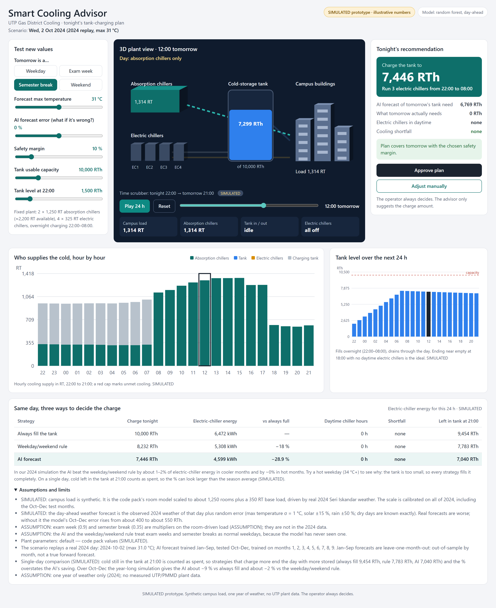

# Smart Cooling Advisor

Localhost MVP of an AI advisor for UTP's gas district cooling plant (TEB2023 Artificial Intelligence student project). Each evening it recommends how much cold to store in the thermal-energy-storage (TES) tank overnight, so tomorrow's peak is covered by the tank and absorption chillers with as little daytime electric-chiller use as possible. The operator always decides; the advisor only suggests.



## Install

```
python -m venv .venv
.venv\Scripts\activate
pip install -r requirements.txt
playwright install chromium     # only needed for the browser tests and screenshots
```

## Run

```
python -m uvicorn app.main:app
```

Open http://127.0.0.1:8000. Startup takes about 12 s (the first run also builds `data/campus_load_2024_<hash>.csv`).

## Test

```
pytest -q                  # everything, including browser (e2e) tests
pytest -q -m "not e2e"     # skip the browser tests
python scripts/screenshots.py   # regenerate docs/screenshots/*.png
```

## Labels: what is SIMULATED, MEASURED, PROPOSED

- **SIMULATED**: the output of our model plus our assumptions. Every energy, load, tank and plant number in the app and API is simulated and carries this label.
- **MEASURED**: only the step1 classifier accuracy, 0.788, on real 2024 weather, Oct-Dec test set. Nothing else here is measured.
- **PROPOSED**: the advisor decision and workflow itself (forecast tomorrow's tank need, add a safety margin, charge to that level, operator approves).

## How it works

1. At startup a `DayBank` is built: a synthetic 2024 campus load driven by real 2024 Seri Iskandar weather, and a random-forest forecaster of tomorrow's tank need.
2. A request (day type, forecast max temperature, margin, tank size and level, forecast error) selects the nearest real 2024 day of that day type (a day in Oct-Dec within 1 C is preferred).
3. For that day three dispatches are simulated hour by hour: always fill the tank, the weekday/weekend rule, and the AI forecast. The API returns the recommendation, hourly profile and a comparison table.

Hot weekday note: asking for "weekday, 34 C" picks the hottest Oct-Dec weekday, 23 Oct 2024 (33.2 C), because 34 C is beyond any weekday in the data. That is expected. The tank is too small there, so every strategy fills it nearly completely.

## Project layout

- `app/` FastAPI app, forecaster, scenario selection, plant dispatch (`app/legacy` is the only import path into `scs/`)
- `scs/` original code pack (read-only)
- `static/` the one-page dashboard (plain HTML/JS/CSS)
- `tests/` unit, API and Playwright tests
- `scripts/screenshots.py` starts the server on port 8765 and captures the screenshots
- `docs/` prompts, plan, screenshots

## Honesty notes

**Forecaster.** Oct-Dec forecasts come from a model trained on Jan-Sep only; Oct-Dec never enters training. Jan-Sep scenario days use leave-one-month-out models (trained on the other Jan-Sep months, including later ones). That is out-of-sample by month, not a true forward forecast.

**Features known at 22:00.** Previous-day load, temperature, heat-index and rain aggregates use the 24 h window 22:00 (D-2) to 21:00 (D-1), which is all that is known at decision time. This deviates slightly from step5, which used calendar-day totals including 22:00-23:59 of the decision night. Oct-Dec mean absolute error of tomorrow's tank need: ours 404.6 RTh (8.8 % of the mean need of 4,602 RTh) versus step5's 385.7 RTh.

**Day-ahead weather forecast is SIMULATED.** It is the observed 2024 weather of that day plus random error (max temperature sigma = 1 C, solar +/-15 %, rain +/-50 %; dry days known exactly). Real forecasts are worse. Without it the Oct-Dec error rises from about 400 to about 550 RTh.

**Single-day comparison caveat.** Cold left in the tank at 21:00 is counted as spent, so one day's percentage can overstate the AI's saving; the table shows "Left in tank at 21:00". Over Oct-Dec the year-long simulation (step5 `plant_results.csv`: always fill 373.7 MWh, calendar rule 346.4, AI 338.9, perfect foresight 336.5) gives the AI about -9 % versus always fill and about -2 % versus the weekday/weekend rule.

## Assumptions

- The campus load is synthetic; its scale is calibrated on all of 2024, including the Oct-Dec test months.
- Exam week (0.9) and semester break (0.35) are ASSUMED multipliers on the room-driven load. The AI and the weekday/weekend rule treat them as ordinary weekdays (the model never saw a break), so on a semester break the AI over-charges, as the semester-break screenshot shows.
- Plant: 2 x 1,250 RT absorption chillers, 4 x 325 RT electric chillers, overnight charging 22:00-08:00.
- Plant parameter preset: set `SCA_PARAMS_PRESET=published_utp_data` to use published-style values (ASSUMPTION: standby loss 0.05 %/h, electric chillers 0.82 kW/RT plus 0.24 kW/RT auxiliaries, absorption 1,800 RT). It is not exposed in the UI.

## Known limitations

- The campus load is synthetic, not measured.
- Only one year of weather (2024).
- No PMMD / UTP plant data.
- No public holidays.
- The day-ahead weather forecast is simulated.
- The phone alert (sketch page 2) is not built.

## Screenshots

| Cool weekday (29 C, 19 Nov 2024) | Semester break (31 C, 2 Oct 2024) |
|---|---|
|  |  |
